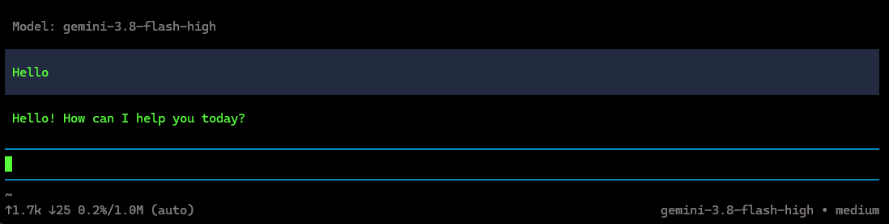

# pi-gemini-auth

<p align="center"></p>

> [!WARNING]
> Pi removed Antigravity and Gemini CLI support because using third-party software with Google OAuth credentials for Antigravity or Cloud Code Assist violates Google's Terms of Service.
> **Switch accounts or pause usage every 4-6 hours for your account safety or you can use [Antigravity IDE](https://antigravity.google/) directly.**



A small local rotator for the [Pi coding agent](https://github.com/badlogic/pi-mono). It holds your Google Antigravity accounts, serves them behind one OpenAI-compatible endpoint, **and moves to the next account when one hits its quota**. Pi sees a single provider and never asks for a Google login.

```bash
npm install -g pi-gemini-auth
pi-gemini-auth login          # add a Google account; repeat for more
pi-gemini-auth setup          # starts the rotator and points Pi at it
```

```
✔ Started the rotator in the background (pid 41236). Stop it with: pi-gemini-auth stop
✔ Rotator reachable at http://127.0.0.1:51300 (2 account(s), 27 models)
✔ 17 model(s) selected (filter: gemini-*)
✔ Wrote provider "gemini-rotator" to ~/.pi/agent/models.json
✔ Test request to gemini-3.8-flash-medium succeeded in 1.6s → "ok"

Done. Restart Pi, open the model picker and choose a model under "gemini-rotator".
```

## How it works

```
Pi ──openai-completions──▶ pi-gemini-auth (127.0.0.1:51300) ──v1internal──▶ Cloud Code Assist
                                  │                                         (account 1, 2, 3...)
                                  └─ 429 on account 1? retry on account 2
```

- **Rotation.** By default an account stays in use until Google rate limits it (`sticky`), which keeps prompt caching warm. Then the rotator puts that account on cooldown for that model, using the reset time Google sends, and retries on the next account. The client never sees the 429. When every account is cooling down, short waits (up to 20s) are absorbed; longer ones come back as HTTP 429 with `Retry-After`. Use `--strategy round-robin` to spread every request instead.
- **Accounts.** Access tokens are refreshed in memory. A revoked login disables that account and the rest keep working. Accounts added with `login` while the rotator runs are picked up without a restart.
- **Models.** The list comes live from Google (`fetchAvailableModels`) with real context windows, output limits, thinking and image support. It is cached on disk for a quick start.
- **Thinking and tools.** Gemini 3 rejects a tool-call turn unless each function call comes back with its thought signature, and Claude needs its signed thinking block back. Chat Completions has no field for this, but Pi returns `reasoning_details` verbatim on the next request. The rotator stores each response's part layout and signatures there and rebuilds the turn exactly. When a signature is missing, for example after switching models mid-session, it sends Google's documented placeholder for Gemini, or turns thinking off for that request for Claude.

## Commands

| Command                             | What it does                                                            |
| ----------------------------------- | ----------------------------------------------------------------------- |
| `pi-gemini-auth login`              | Add a Google account. Opens the browser; or paste the redirect URL      |
| `pi-gemini-auth accounts [--check]` | List accounts and cooldowns; `--check` also shows quota left per family |
| `pi-gemini-auth logout <email>`     | Remove an account                                                       |
| `pi-gemini-auth start [--detach]`   | Run the rotator in this terminal, or in the background                  |
| `pi-gemini-auth stop`               | Stop the background rotator                                             |
| `pi-gemini-auth` / `setup`          | Configure Pi; starts the rotator first if it is not running             |
| `pi-gemini-auth status`             | Check Pi config, accounts and the rotator                               |
| `pi-gemini-auth remove`             | Remove the provider from Pi                                             |

## Options

| Option                     | Default              |                                                                                        |
| -------------------------- | -------------------- | -------------------------------------------------------------------------------------- |
| `--port <n>`, `--host <h>` | `51300`, `127.0.0.1` | Where the rotator listens. Saved defaults live in `config.json`                        |
| `--strategy <s>`           | `sticky`             | `sticky` or `round-robin`                                                              |
| `--models <globs>`         | `gemini-*`           | Comma-separated filter; `!` excludes. Example: `"gemini-3.8-*,claude-sonnet-*,!*-low"` |
| `--all`                    | off                  | Every chat model (Claude, GPT-OSS...), not just Gemini                                 |
| `--provider <id>`          | `gemini-rotator`     | Provider name in Pi                                                                    |
| `--api-key <key>`          | from `config.json`   | Key Pi uses to call the rotator. Generated on first run                                |
| `--url <url>`              |                      | Use a rotator running elsewhere (setup/status)                                         |
| `--keep-legacy`            | off                  | Keep old `google-antigravity` placeholder entries                                      |
| `--no-start`               | off                  | setup: fail instead of starting the rotator                                            |
| `--no-verify`              | off                  | setup: skip the test request                                                           |
| `--no-browser`             | off                  | login: print the URL instead of opening it                                             |
| `--dry-run`                | off                  | Print what would change without writing                                                |
| `--pi-dir <path>`          | `~/.pi/agent`        | Pi config folder (env `PI_AGENT_DIR`)                                                  |
| `--home <path>`            | `~/.pi-gemini-auth`  | Rotator folder (env `PI_GEMINI_AUTH_HOME`)                                             |

Exit codes: `0` success, `1` failed, `2` Pi is configured but the test request failed (for example, every account is cooling down).

## Files

Everything lives in `~/.pi-gemini-auth/`, written atomically with `0600` permissions:

| File                         | Contents                                                |
| ---------------------------- | ------------------------------------------------------- |
| `accounts.json`              | Email, refresh token and Cloud Code project per account |
| `config.json`                | Port, host, rotation strategy and the generated API key |
| `models-cache.json`          | Last model list from Google                             |
| `rotator.log`, `rotator.pid` | Background rotator output and process id                |

Pi's `models.json` and `auth.json` are backed up (`*.bak-<time>`) before every change. Only our provider and the old placeholder entries are touched.

## API

The rotator speaks the OpenAI Chat Completions API, so other clients can use it too. Send `Authorization: Bearer <apiKey from config.json>`.

| Route                       |                                                                 |
| --------------------------- | --------------------------------------------------------------- |
| `GET /health`               | Name, version, account count. No key needed                     |
| `GET /v1/models`            | Live model list with `context_window` and `meta` limits         |
| `POST /v1/chat/completions` | Streaming and non-streaming; tools, images, `reasoning_content` |
| `GET /v1/accounts`          | Account states and cooldowns, no secrets                        |

## Troubleshooting

| Message                                    | Fix                                                                                        |
| ------------------------------------------ | ------------------------------------------------------------------------------------------ |
| No Google accounts yet                     | `pi-gemini-auth login`                                                                     |
| Something else is answering at ...         | Another server holds the port. Stop it, or use `--port`                                    |
| Google did not return a Cloud Code project | New account: open it once in the Antigravity IDE and send a message, then log in again     |
| All accounts are rate limited (HTTP 429)   | Wait for the reset shown, or add an account. `pi-gemini-auth accounts --check` shows quota |
| Account disabled: refresh token revoked    | `pi-gemini-auth login` with that account again                                             |
| Pi still asks for a Google login           | You picked a built-in Google provider. Choose a model under **gemini-rotator**             |

The request headers mimic the Antigravity IDE. If Google changes them, override without a new release: `PGA_ANTIGRAVITY_VERSION`, `PGA_USER_AGENT`, `PGA_API_CLIENT`, `PGA_CLIENT_METADATA`, `PGA_ENDPOINTS` (comma-separated), `PGA_CLIENT_ID`, `PGA_CLIENT_SECRET`.

## Development

Written in TypeScript; no runtime dependencies. Node 22.18+ runs the sources and tests directly; the published package ships compiled JavaScript that runs on Node 20+.

```bash
npm install
npm test            # node:test against a mock Google, no network
npm run typecheck
npm run build       # dist/, used by bin/pi-gemini-auth.js
```

## Note

This talks to Google's internal Cloud Code Assist API the way the Antigravity IDE does, with your own Google accounts. That is outside Google's supported APIs and may break or conflict with Google's terms of service. Use it at your own risk.

## License

MIT. You can fork this repository and use the rotator for other providers outside Antigravity or Cloud Code Assist.
